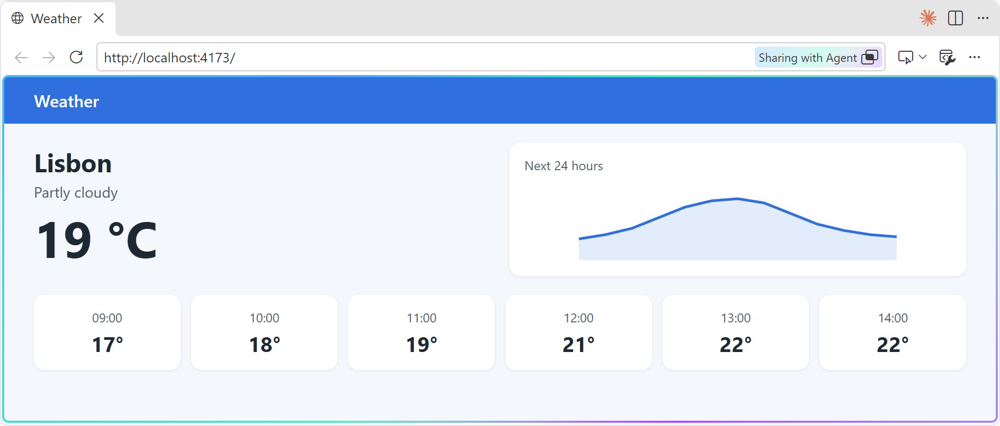
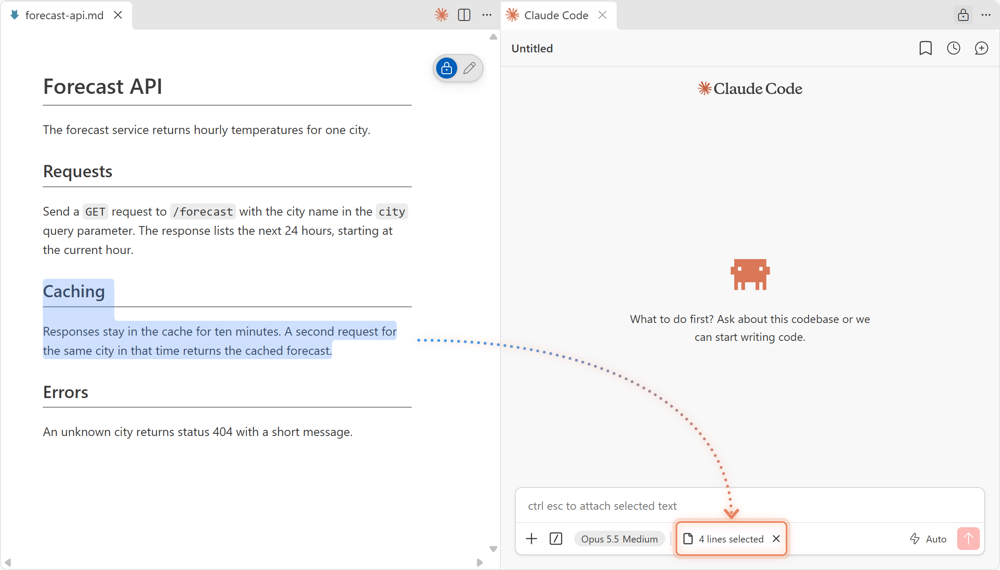
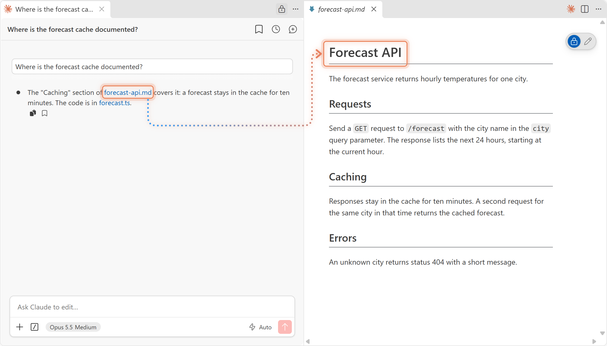
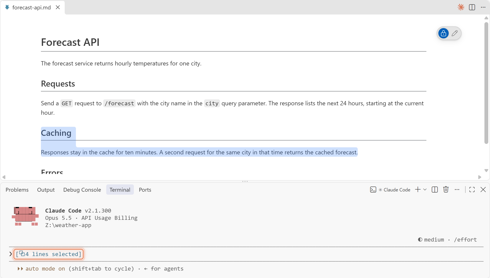
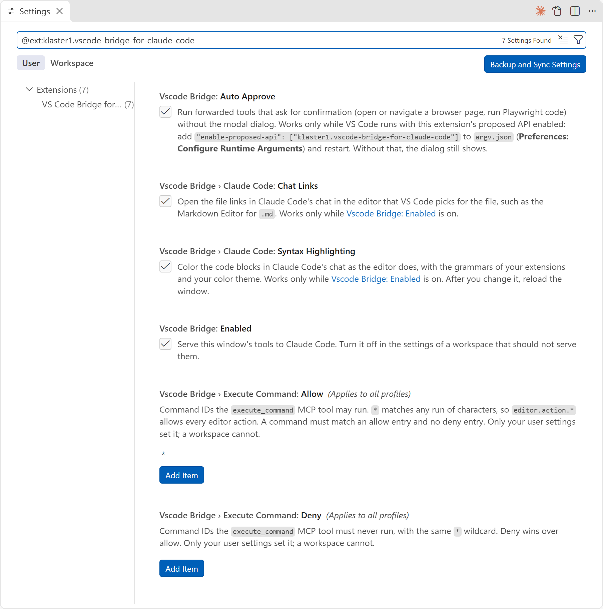
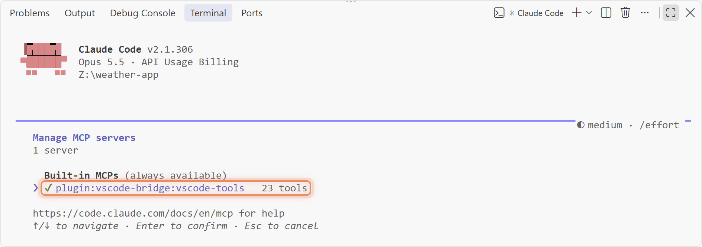

# VS Code Bridge for Claude Code

A VS Code extension that gives Claude Code (the CLI) the tools and the screen of the VS Code window it works in.

## Claude uses VS Code's tools

Claude gets these tools as the `vscode-tools` MCP server. Ask for the result, such as "check
this file for type errors", and Claude picks the tool.

| Tool | What it does |
|------|--------------|
| `get_diagnostics` | Type errors and lint findings from the Problems panel, for the workspace or for given files. |
| `rename_symbol` | Renames a symbol across the workspace, with its imports and references, and saves the files. |
| `execute_command` | Runs any VS Code command, such as go to definition, find references, a formatter or a git command. |
| `list_commands` | Lists the commands `execute_command` may run. |
| `open_files` | Opens files in the editor, at a given line. |
| `list_workspaces` | The window's workspace folders. |
| `semantic_search`, `vscode_api_reference` | Copilot's codebase search and VS Code API reference. Needs GitHub Copilot, signed in. |
| `terminal_selection`, `terminal_last_command` | The text selected in the terminal, and the terminal's last command. Needs VS Code chat. |
| `open_browser_page`, `read_page`, `screenshot_page`, `click_element` and other browser tools | Open, read and screenshot pages in VS Code's integrated browser, click, hover, drag and type there, and run Playwright code. Needs `workbench.browser.enableChatTools` on. |

Claude also knows the steps for sharp page screenshots, page videos and VS Code commands, such as
a diff or a comment box on a pull request line. Ask for the result.

To show Claude a page you have open in the integrated browser, press **Share with Agent** in
the page toolbar. Claude knows which pages you share, so "this page" needs no explanation.



## Claude sees what you have open

Claude can look at an image file (PNG, JPEG, GIF or WebP) you have in front in an editor group,
and knows which one, so "this screenshot" needs no path. Text you select in the Markdown Editor
shows in Claude Code's selection chip, and Claude gets it with your prompt, as it does for a text
editor.



If you don't see your selection, reopen the file.

## Chat links open in the editor you chose

A file link in Claude Code's chat opens in the editor VS Code uses for that file type. That is
the Markdown Editor for `.md` when you set it in `workbench.editorAssociations`, or a PDF viewer
from an extension. Without the bridge, Claude Code opens every link in the text editor
([anthropics/claude-code#81482](https://github.com/anthropics/claude-code/issues/81482)).



A link to a line or a heading opens the file at the top.

## The Claude Code CLI

You can also run `claude` in a terminal and connect it to VS Code with `/ide`. Claude then has
the tools and sees the images you have in front. The CLI shows your Markdown Editor selection, as it
does for a text editor. Chat links do not apply, since they belong to the extension's chat
panel. `/ide` needs Claude Code's VS Code extension installed.



## Settings



| Setting | Default | Effect |
|---------|---------|--------|
| [`vscodeToolsBridge.enabled`](vscode://local.vscode-tools-bridge/settings?id=vscodeToolsBridge.enabled) | `true` | Serves the window's tools. Set it to `false` in a workspace's settings to turn the bridge off there. |
| [`vscodeToolsBridge.executeCommand.allow`](vscode://local.vscode-tools-bridge/settings?id=vscodeToolsBridge.executeCommand.allow) | `["*"]` | Command IDs `execute_command` may run. `*` matches any run of characters. Only your user settings set it, not a workspace's. |
| [`vscodeToolsBridge.executeCommand.deny`](vscode://local.vscode-tools-bridge/settings?id=vscodeToolsBridge.executeCommand.deny) | `[]` | Command IDs it must never run. Deny wins over allow. Only your user settings set it, not a workspace's. |
| [`vscodeToolsBridge.autoApprove`](vscode://local.vscode-tools-bridge/settings?id=vscodeToolsBridge.autoApprove) | `true` | Skips the browser confirmation dialog. |
| [`vscodeToolsBridge.markdownEditor.selection`](vscode://local.vscode-tools-bridge/settings?id=vscodeToolsBridge.markdownEditor.selection) | `true` | Sends the Markdown Editor's selection to Claude. After you turn it on, reopen an open Markdown Editor, and reload the window for the CLI. |
| [`vscodeToolsBridge.claudeCode.chatLinks`](vscode://local.vscode-tools-bridge/settings?id=vscodeToolsBridge.claudeCode.chatLinks) | `true` | Opens chat links in the editor you chose. A change takes effect without a reload. |

To keep Claude from closing the window, for example:

```jsonc
"vscodeToolsBridge.executeCommand.deny": ["workbench.action.quit", "workbench.action.closeWindow"]
```

## Install

The bridge has two parts: a VS Code extension, and a Claude Code plugin that connects Claude Code
to it. You need VS Code 1.138 or later, Node 22.18 or later, and Claude Code. The bridge is not on
the Marketplace.

### From a release

1. Download the `.vsix` file from the repo's Releases page.
2. Install it: run `code --install-extension <file>`, or use **Install from VSIX...** in the
   Extensions view.
3. Reload each open VS Code window with **Developer: Reload Window**.
4. Install the Claude Code plugin:

   ```sh
   claude plugin install vscode-bridge --marketplace Klaster1/vscode-bridge-for-claude-code
   ```

   In a Claude Code session, run `/plugin marketplace add Klaster1/vscode-bridge-for-claude-code`,
   then `/plugin install vscode-bridge@vscode-bridge`.
5. Run **Preferences: Configure Runtime Arguments**, add this line to `argv.json` and restart
   VS Code. It lets Claude use the browser without a confirmation dialog.

   ```jsonc
   "enable-proposed-api": ["local.vscode-tools-bridge"]
   ```

To update, install the new `.vsix` and reload the VS Code windows. Then update the plugin and
start a new Claude Code session:

```sh
claude plugin marketplace update vscode-bridge
claude plugin update vscode-bridge@vscode-bridge
```

### From a clone

You also need the `code` command on your PATH. With Claude Code, start `claude` in the clone and
ask it to install the bridge. Its `install-vscode-tools-bridge` skill runs the setup script and
makes the settings edits. It asks you before it changes each file.

Without the skill, run this in the clone:

```sh
npm run setup
```

The script builds the extension, installs it into VS Code and installs the Claude Code plugin from
the clone. It then prints the steps left to you. The plugin runs from the clone, so a change there
takes effect in the next Claude Code session.

To update, run `git pull` and `npm run setup`, then reload the VS Code windows.

### Check

Start `claude` in the window's first workspace folder or a folder below it. `/mcp` lists
`plugin:vscode-bridge:vscode-tools` as connected, and the **VS Code Bridge for Claude Code**
output channel logs each call. After a window reload, run `/mcp` and reconnect the server.



### Uninstall

Uninstall the extension in the Extensions view. Then remove the plugin:

```sh
claude plugin uninstall vscode-bridge@vscode-bridge
claude plugin marketplace remove vscode-bridge
```
